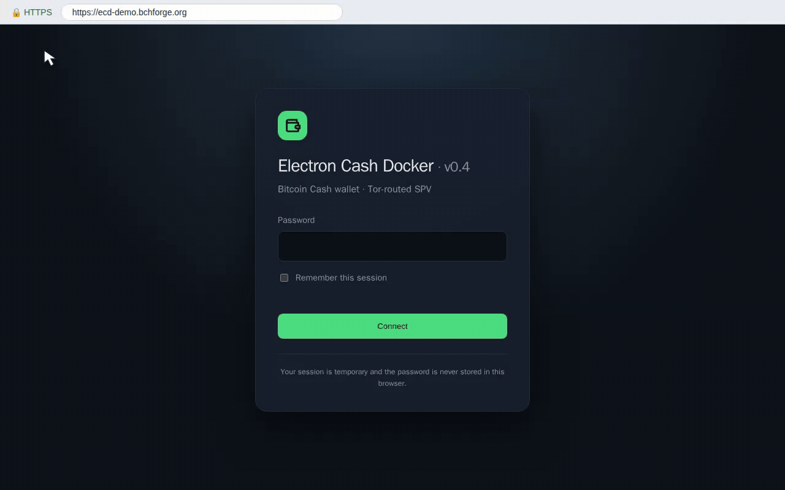

<p align="center">
  
</p>

# Electron Cash Docker

Electron Cash Docker packages [Electron Cash](https://github.com/Electron-Cash/Electron-Cash),
the Bitcoin Cash SPV wallet, for a local browser through noVNC. It includes
persistent wallet data, Tor networking, and a default-enabled CashFusion plugin
with opt-in automatic fusion.

## Current v0.2 Scope

Starting from the accepted `v0.1.4` baseline, v0.2 adds:

- A build-time verified external-plugin supply chain with explicit source,
  release version, archive SHA-256, and deterministic ZIP SHA-256.
- The official Flipstarter Helper plugin at v1.5.0, enabled by the trusted
  manifest and compatible with Electron Cash 4.4.6.
- An explicit headless Electron Cash daemon mode without the graphical stack.
- Optional Electron Cash JSON-RPC, disabled by default and exposed only through
  the explicit localhost-only RPC Compose override with a required password.

The normal GUI/noVNC deployment retains the v0.1.4 behavior and is the final
inspection mode.

`v0.1.4` is the baseline maintenance release within the existing `v0.1` scope.
It retained Electron Cash 4.4.6, the standalone BCH Forge Tor 0.4.9.11 service,
and the existing local browser runtime while improving noVNC connection
reliability. It continues to provide local browser access, persistent Electron
Cash data, Tor for explicitly configured SPV and CashFusion traffic, the
default-enabled CashFusion plugin with opt-in auto-fusion, and a test-only
testnet4 override.

Electron Cash Docker is developed as an independent open-source project.
Additional features are organized by later release and are not part of `v0.2`.

## Demo



This demonstration uses testnet4, whose coins have no monetary value. It shows
the real Electron Cash Docker browser interface with isolated disposable test
data, the testnet4 network view, Tor and CashFusion configuration, and the
verified Flipstarter external plugin. Automatic fusion remains opt-in; no real
BCH or live CashFusion round is involved.

## Quick Start

Requirements:

- Docker Engine 20.10 or newer.
- Docker Compose v2.
- At least 2 GB of available memory.
- Approximately 2 GB of disk space for the image.

```bash
git clone https://github.com/bchforge/electron-cash-docker.git
cd electron-cash-docker
cp .env.example .env
docker compose build
docker compose up -d
```

Open <http://127.0.0.1:6080/>. The first start opens Electron Cash's wallet
setup wizard. Docker Compose creates the named volume
`bchforge-electron-cash-data` automatically. It is mounted at
`/home/electroncash/.electron-cash` and survives container restarts and normal
`docker compose down` operations. On first use the container adds a
`.electron-cash-docker` marker after checking the empty volume. Later starts
reject invalid markers, symbolic links, incompatible ownership, and ineffective
access instead of changing existing data recursively.
The Tor image is built locally during `docker compose build` from the pinned
Tor Project source release; no third-party Tor container image is pulled. Tor
client state is stored separately in `bchforge-electron-cash-tor-data`.

### Verified Plugins

The root [`plugins.json`](plugins.json) is the trusted plugin manifest. Each
entry records the upstream source, release version, source archive SHA-256,
deterministic plugin ZIP SHA-256, and activation state.
The Docker build fetches the exact archive, verifies it before extraction,
validates the plugin metadata, creates a deterministic ZIP, and fails closed on
either digest mismatch. The runtime verifies the image artifact again before
copying it to Electron Cash's network-specific `external_plugins` directory.

The only bundled external plugin in v0.2 is Flipstarter Helper v1.5.0 from
[`flipstarter/flipstarter-electron-cash`](https://gitlab.com/flipstarter/flipstarter-electron-cash).
It is a Qt plugin and is not represented as a headless CLI feature. The image
does not download plugins at runtime and does not implement a plugin registry or
marketplace.

The build path can be checked without starting a container:

```bash
bash docker/plugins/build_plugins.sh
bash docker/plugins/build_plugins.sh --verify-only
```

`--verify-only` requires an existing ZIP and never falls back to a remote
artifact or a latest version.

### Headless Mode

Headless mode is an explicit alternative to the default GUI/noVNC mode. It uses
the same Electron Cash image, named wallet volume, network-specific data path,
CashFusion configuration, UID/GID, and Tor sidecar. It starts Electron Cash's
upstream daemon through a Qt-free wrapper and does not start Xvfb, Openbox,
x11vnc, or websockify.

```bash
docker compose -f docker-compose.yml -f docker-compose.headless.yml up -d
docker compose exec --user 10001:10001 electron-cash \
  /opt/electroncash-venv/bin/electron-cash daemon status
```

An encrypted production wallet is not automatically unlocked. The supported
security boundary is operator loading/unlocking through Electron Cash. The
testnet4-only `WALLET_AUTO_CREATE` and `TEST_WALLET_PASSWORD` path remains
available for disposable test runs only.

### Optional JSON-RPC

JSON-RPC is disabled in the default GUI deployment and in the plain headless
override. Do not publish the RPC port by editing the normal Compose file. For a
explicit RPC override and non-empty credentials in the ignored `.env` file:

```bash
docker compose -f docker-compose.yml \
  -f docker-compose.headless.yml -f docker-compose.rpc.yml up -d
```

The daemon listens on its container interface, while Docker publishes the host
socket only as `127.0.0.1:${JSONRPC_HOST_PORT:-50001}`. Missing, empty, malformed,
or unsupported credentials fail before daemon startup. The password is not
logged, put in command arguments, or included in generated URLs. Docker
administrators may inspect the configured environment, including credentials,
as part of the deployment's host-level trust boundary. Remove the RPC override
and recreate the service to return to the default disabled state.

### Volume Management

List and inspect the data volume with ordinary Docker commands:

```bash
docker volume ls --filter name=bchforge-electron-cash
docker volume inspect bchforge-electron-cash-data
```

Docker Desktop users can open **Volumes**, select
`bchforge-electron-cash-data`, and browse its files. To inspect files without
writing to the volume, stop the stack and use a read-only helper:

```bash
docker compose down
docker run --rm --read-only --network none --cap-drop=ALL \
  --user 10001:10001 \
  --mount type=volume,src=bchforge-electron-cash-data,dst=/data,readonly \
  --entrypoint /bin/bash electron-cash:4.4.6 \
  -c 'find /data -maxdepth 3 -print'
```

Do not edit live Electron Cash files while the application is running. Do not
use Docker's internal paths such as `/var/lib/docker/volumes` as a normal
management method.

To intentionally erase all wallet data, stop the stack first and remove the
volume explicitly:

```bash
docker compose down
docker volume rm bchforge-electron-cash-data
```

Volume deletion is permanent. `docker compose down -v` also removes this
Compose-managed volume, so it must not be used casually. Keep the recovery seed
independently; persistence is not a backup. Encrypted manual backup and tested
restoration remain planned for `v0.3`.

## Tor And CashFusion

Electron Cash routes SPV traffic through the internal `tor-proxy` service by
default.

Electron Cash Docker deliberately uses this standalone `tor-proxy` service
instead of relying on a Tor daemon owned by the Electron Cash application. Tor
is independently versioned, health-checked, restarted, and hardened in its own
container boundary, without access to the wallet volume. Electron Cash and
CashFusion explicitly consume its stable Docker-internal SOCKS endpoint at
`tor-proxy:9050`; future components may reuse it only when explicitly
configured. Electron Cash 4.4.6's upstream packaged Tor does not replace this
service. This is not a transparent gateway: only traffic explicitly configured
for `tor-proxy:9050` uses it.

The `tor-proxy` image is a BCH Forge multi-stage build in
[`docker/tor/`](docker/tor/). It downloads Tor `0.4.9.11` from the official Tor
Project source distribution, verifies the Tor Project release signature and
the pinned SHA-256 before compilation, and runs the resulting client as UID/GID
`10001:10001`. The signed release process, key fingerprints, Docker stages,
license handling, and update procedure are documented in
[`docs/tor-supply-chain.md`](docs/tor-supply-chain.md).

Only SOCKS5 is enabled at `tor-proxy:9050`. The endpoint is Docker-internal:
Compose uses `expose`, not a host `ports` mapping. The Tor container has no
ControlPort, HTTP proxy, DNS proxy, relay, bridge, onion-service, Nyx, or
Lyrebird capability. Tor's local healthcheck tests the SOCKS handshake without
contacting an external website; acceptance tests separately verify bootstrap
and a Tor-routed connection.

The CashFusion plugin is enabled by default and preconfigured to use Tor.
Automatic background fusion remains disabled until explicitly enabled:

```bash
CASHFUSION_AUTO_FUSE=true docker compose up -d
```

`CASHFUSION_ENABLED=false` disables the plugin entirely. If auto-fuse is true
while the plugin is disabled, the auto-fuse setting is ignored. For a normal
encrypted wallet, Electron Cash requests its password through the GUI before
background fusions can start. The environment-password exception is limited to
the automated testnet4 path described above.

The deployment values are reapplied when the container starts. While the plugin
is enabled, `CASHFUSION_AUTO_FUSE` is applied as each eligible wallet opens and
can override that wallet's previous GUI auto-fusion choice.

Enabling auto-fuse means Electron Cash will attempt eligible fusion rounds. It
does not guarantee completed rounds, privacy against every threat, or the
availability of compatible servers.

## Operation And Development

Canonical validation commands are shared by local development and GitHub
Actions:

```bash
./scripts/ci.sh fast        # source/static checks; no container acceptance
./scripts/ci.sh acceptance  # isolated uncached builds, scans, and runtime tests
```

The acceptance command requires the default local Docker context and refuses
remote Docker endpoints. It builds unique candidate wallet and Tor image
references and never uses a pre-existing production-style tag as test evidence.
See [`docs/ci-security.md`](docs/ci-security.md) for the policy and known scan
blind spots.

Use the standard Compose lifecycle commands from the repository root:

```bash
docker compose config
docker compose build
docker compose up -d
docker compose ps
docker compose logs -f electron-cash
docker compose down
```

When upgrading, compare your existing `.env` with the new `.env.example`
before rebuilding. `.env` is a local file and is not updated by Git, so it may
continue to select an older Electron Cash image after the repository has been
updated. Preserve intentional local settings while updating the version and
integrity pins rather than overwriting the whole file. Before starting the
stack, confirm the resolved images:

```bash
docker compose --env-file .env config --images
```

For v0.2, this should include `electron-cash:4.4.6` and
`bchforge/electron-cash-docker-tor:0.4.9.11`.

The Electron Cash and noVNC versions in `.env` have matching commit and archive
integrity pins. Update each version and all of its pins together. The Ubuntu
base image is pinned by digest, and the Tor source version and SHA-256 are
required build pins in `.env.example`; builds do not silently consume a
different source artifact under the same version.

To inspect or rebuild only the Tor component:

```bash
docker compose --env-file .env.example build tor-proxy
docker run --rm --entrypoint /usr/local/bin/tor \
  bchforge/electron-cash-docker-tor:0.4.9.11 --version
python3 tests/test_tor_proxy.py
```

After building the image, run the CashFusion state matrix with:

```bash
python3 tests/test_cashfusion_states.py
```

Run the capability-focused plugin, Flipstarter, headless, and JSON-RPC checks with:

```bash
python3 tests/test_plugin_distribution.py
python3 tests/test_flipstarter_plugin.py
python3 tests/test_headless.py
python3 tests/test_rpc.py
```

The v0.1 persistence, Tor, CashFusion, noVNC, and testnet4 behavior remains the
regression baseline for the v0.2 additions above.

Source code and current project documentation are maintained in English.
English and Spanish setup and security documentation is planned for `v1.0`.

## Security Warnings

- The noVNC port binds to `127.0.0.1` by default.
- `v0.1` provides no authentication or project-provided TLS for noVNC. Do not
  publish the port or change `NOVNC_BIND` to a non-loopback address.
- A direct public noVNC mapping is outside the supported security model. HTTPS
  and Basic Auth are planned for `v0.3`.
- Set a wallet password inside Electron Cash before using meaningful funds.
- Keep the recovery seed offline and never put a real seed in `.env`.
- A compromised Docker host can read the Docker-managed wallet volume.
- Persistence is not a backup. A project-managed encrypted backup and tested
  restoration are planned for `v0.3`.
- Tor protects only the configured Electron Cash and CashFusion traffic through
  `tor-proxy:9050`, not the browser, host, wallet volume, or every application
  on the machine.
- In `v0.1`, the internal passwordless VNC endpoint shares a Docker network with
  the bundled Tor proxy. Attach no additional containers to that network.
  Isolating internal GUI services is planned as part of `v1.0` hardening.
- v0.2 headless mode and optional JSON-RPC are supported release features. RPC
  remains disabled by default and the password-protected host mapping is
  localhost-only.

## Testnet4 Testing

The normal setup uses mainnet. For no-funds testing, stop the current stack and
start the testnet4 override:

```bash
docker compose down
docker compose -f docker-compose.yml \
  -f docker-compose.testnet4.yml up -d
```

The override starts Electron Cash with the `--testnet4` flag. With the default
Docker-managed volume, testnet4 data is kept under the internal
`/home/electroncash/.electron-cash/testnet4` directory. Mainnet data remains at
the volume root. Stop the current stack before switching between mainnet and
testnet4 because both paths use the same data volume. Do not use this
environment for real funds.

For an automated encrypted test wallet, use the testnet4-only variables:

```bash
WALLET_AUTO_CREATE=true \
TEST_WALLET_PASSWORD=cashfusion-test-password \
CASHFUSION_AUTO_FUSE=true \
docker compose -f docker-compose.yml \
  -f docker-compose.testnet4.yml up -d
```

The generated seed is suppressed from container logs. Mainnet rejects
`WALLET_AUTO_CREATE=true` and any non-empty `TEST_WALLET_PASSWORD`.
`TEST_WALLET_PASSWORD` is intentionally read from the environment only for this
automated testnet4 path and must never contain a production wallet password.
`CASHFUSION_AUTO_FUSE` is a general CashFusion control and is not restricted to
testnet4.

## Release Roadmap

- [x] `v0.1`: browser access, persistent wallet data, Tor, the CashFusion plugin
  with opt-in auto-fusion, and a test-only testnet4 override.
- [x] `v0.2`: secure plugin distribution, Flipstarter Helper, headless mode, and
  optional password-authenticated JSON-RPC disabled by default.
- [ ] `v0.3`: HTTPS, Basic Auth, fail2ban, additional CashFusion defaults for
  target amount, fee budget, and minimum UTXO, plus encrypted backup and tested
  restoration.
- [ ] `v0.4`: native X11 on the validated Linux path, XQuartz on the validated
  macOS path, every network supported by the pinned Electron Cash version with
  isolated data, and Ledger on native Linux Docker Engine.
- [ ] `v1.0`: hardening, including internal GUI service isolation,
  interface-language selection, maintainer-run security validation,
  documentation of the built-in noVNC virtual keyboard, English and Spanish
  setup and security documentation, expanded browser, arm64, and integration
  tests, demo, release evidence, and final accountability report.

## License

MIT. See [LICENSE](LICENSE).

Tor is separate upstream work and is distributed under the Tor Project's
3-clause BSD license with its bundled notices. The exact Tor license is copied
into the Tor runtime image at `/usr/share/doc/tor/LICENSE`; see
[`docs/tor-supply-chain.md`](docs/tor-supply-chain.md) for the supply-chain
record.
